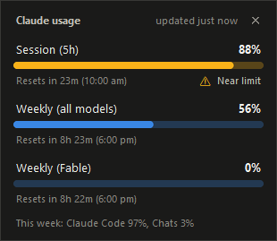

# claude_usage_widget

A Windows tray icon and small desktop panel showing Claude plan usage: the 5-hour session limit,
the weekly limits and when each resets. Same numbers as Settings > Usage in the Claude app.



## How it gets the numbers

It reads the OAuth token Claude Code stores in `%USERPROFILE%\.claude\.credentials.json`
(`CLAUDE_CONFIG_DIR` is respected) and calls `https://api.anthropic.com/api/oauth/usage`, the
endpoint behind Claude Code's `/usage`. It polls every 3 minutes, backing off to 10 minutes if
rate limited.

- The endpoint is undocumented and may change. `usage.py` reads the `limits` list first and falls
  back to the older `five_hour` / `seven_day` keys.
- The widget never refreshes the token: refresh tokens rotate, so doing it here would log Claude
  Code out. When the token expires the panel says so; running Claude Code once refreshes it.

## Run

Needs Python 3.10+ on Windows with `pystray` and `Pillow` (`pip install -r requirements.txt`).

```powershell
pythonw widget.py
```

`pythonw` keeps a console window from opening. A second launch exits straight away, so only one
icon ever shows.

## Use

- **Tray icon:** the session % on a coloured square. Blue below 75%, amber from 75%, red from 90%,
  grey when the numbers are stale (offline, rate limited or logged out). Hover for both limits and
  their reset times. Windows 11 puts new icons in the overflow (^): drag it onto the taskbar to
  keep it visible.
- **Left-click the icon** to show or hide the panel.
- **Panel:** drag it anywhere; it stays inside the monitor it sits on. Right-click it for Refresh,
  Keep on top, Hide and Quit.
- **Tray menu** (right-click the icon): Show panel, Refresh now, Keep panel on top,
  Start with Windows, Quit. Start with Windows writes `ClaudeUsageWidget` under
  `HKCU\Software\Microsoft\Windows\CurrentVersion\Run`; unticking it removes the value.

Panel position and toggles are saved in `%LOCALAPPDATA%\claude_usage_widget\settings.json`;
warnings go to `widget.log` beside it.

## Test

```powershell
python -m unittest discover -s tests
```

## Files

- `usage.py`: token, fetch, parsing and formatting. No UI, covered by `tests/`.
- `widget.py`: tray icon (pystray), panel (tkinter), polling thread, settings.

## Licence

MIT. Not affiliated with or endorsed by Anthropic.
